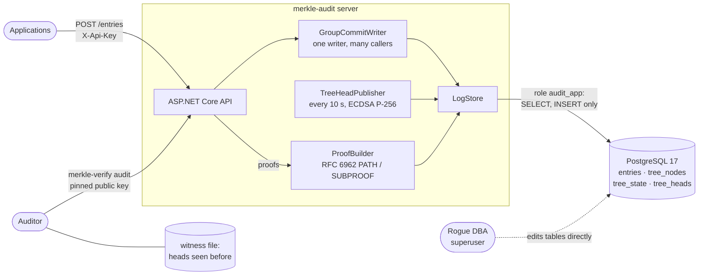
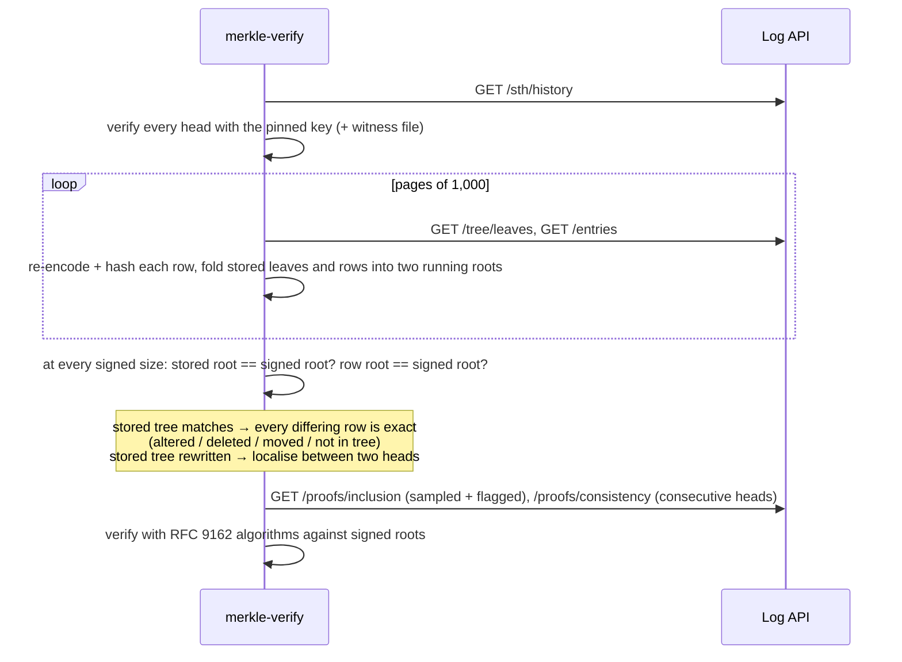

# merkle-audit

[](https://github.com/hekimcan206/merkle-audit/actions/workflows/ci.yml)
[](https://github.com/hekimcan206/merkle-audit/actions/workflows/codeql.yml)


[](LICENSE)

A tamper-evident audit log for .NET 10 and PostgreSQL. Every entry is a leaf of an **RFC 6962 (Certificate
Transparency) Merkle tree**. The log serves **inclusion and consistency proofs**, publishes **signed tree heads**,
and an **independent verifier** that shares no code with the server checks all of it from the outside. When someone
edits the database directly, the verifier does not just say "the root changed". It names the row that was altered,
deleted, moved or inserted.

> All data is synthetic: actors, patients and payloads are generated. There is no real personal or health data.

## Problem

Audit trails answer "who saw or changed this record, and when". Two things go wrong:

1. **The people the log watches can edit the log.** A database administrator, or anyone holding the superuser
   password, can `UPDATE`, `DELETE` or `INSERT` rows, switch off triggers for their session, and leave no trace.
   Privileges and append-only triggers stop the application, not them.
2. **"Tamper-evident" usually means "a hash chain broke somewhere".** After an incident, the question is *which*
   records changed. A broken chain or a mismatched root does not answer it, and checking a chain means replaying all
   of it.

## Solution

| Concern | How |
|---|---|
| Commit to the whole history in 32 bytes | RFC 6962 Merkle tree: `SHA-256(0x00‖leaf)`, `SHA-256(0x01‖left‖right)`. The prefixes are domain separation against second-preimage attacks ([ADR 0001](docs/adr/0001-rfc6962-merkle-tree-with-stored-perfect-subtrees.md)) |
| Cheap proofs at any size | Every perfect subtree is stored once as an immutable row. Inclusion and consistency proofs for **any historic size** need O(log n) nodes, fetched in one SQL round trip |
| Make the root binding | Signed tree heads: ECDSA P-256 over the RFC 6962 tree-head structure, key id = SHA-256 of the public key, rotation with `notAfter`. The signer **refuses to sign a tree that does not extend its last head** ([ADR 0002](docs/adr/0002-signed-tree-heads-ecdsa-p256-and-key-rotation.md), [key rotation](docs/key-rotation.md)) |
| Check without trusting the server | `MerkleAudit.Verifier` + `merkle-verify` CLI: written separately from the RFC text, iterative RFC 9162 verification (the server uses the recursive RFC 6962 definitions), pinned keys only ([ADR 0003](docs/adr/0003-independent-verifier.md)) |
| Say *what* changed | Three layers checked in order: signed heads → stored leaf hashes → rows. Leaf hashes live apart from the rows, so the tree remembers every entry even after the row is edited. Exact pinpointing; a full tree rewrite is localised between two signed heads ([ADR 0005](docs/adr/0005-tamper-localisation.md)) |
| Throughput without races | One writer per log via the `tree_state` row lock (works across instances); a group-commit writer turns concurrent appends into larger transactions ([ADR 0004](docs/adr/0004-serialised-appends-with-group-commit.md)) |
| Bytes a verifier can reproduce | Length-prefixed binary leaf encoding with the sequence number inside, payload stored as `text` byte for byte ([ADR 0006](docs/adr/0006-canonical-binary-leaf-encoding.md), [log format](docs/log-format.md)) |

## Architecture



What the auditor does with what it reads:



## The tamper demo

```bash
docker compose up            # postgres, keygen, migrator, server, demo — exits when the demo finishes
docker compose run --rm verify   # audit the (restored) log yourself with the standalone CLI
```

The demo seeds 200 synthetic entries (a signed head every 25), then plays the rogue DBA: it connects as the
PostgreSQL superuser, disables the append-only triggers for its session (`session_replication_role = replica`) and
runs each attack. After each one, the independent verifier audits the log over HTTP; the attack is undone and the
log must audit clean again. Abridged output (the full report is the golden file
[`tamper-report.txt`](tests/MerkleAudit.IntegrationTests/Golden/tamper-report.txt)):

```text
=== scenario alter: UPDATE payload of seq 115 to hide an emergency access
stored tree:    matches every signed head (findings are exact)
  RowAltered                   seq 115      leaf 1471f285c10c != committed 6bdc1ee6ffc5

=== scenario delete: DELETE seq 42
  RowDeleted                   seq 42       committed leaf b8541f271517 has no row

=== scenario reorder: swap the content of seq 60 and 61
  RowMoved                     seq 60       row holds the entry committed at seq 61
  RowMoved                     seq 61       row holds the entry committed at seq 60

=== scenario insert: INSERT a forged, back-dated consent as seq 200
  RowNotInTree                 seq 200      row was never committed to the tree

=== scenario rewrite: change seq 160's actor AND recompute its leaf, ancestors and tree_state
stored tree:    does NOT match the signed heads (findings are localised to a range)
  StoredTreeRewritten          stored leaf hashes stop reproducing the signed root between size 150 and size 175: first divergence is in seq [150, 174]
  ConsistencyProofFailed       log cannot prove size 175 extends size 150

{"scenarios":6,"detected":6,"cleanAfterUndo":6,"failures":[]}
```

The same scenarios run in the integration suite against Testcontainers PostgreSQL with a deterministic clock, and the
whole report is compared byte for byte with the golden file. CI runs the compose demo on every push.

## Why this design

- **Store perfect subtrees, not the current tree.** A node covering `[i·2^k, (i+1)·2^k)` is final the moment its last
  leaf arrives, so the table is append-only and the same rows answer proofs for every past size. The right edge of
  the tree is never stored; it is folded from at most 63 frontier nodes when needed.
- **Keep leaf hashes out of the entries table.** If the leaf hash were a column of the row, deleting the row would
  delete the evidence. Kept apart, the tree still "remembers" the deleted or edited entry, which turns detection into
  exact pinpointing.
- **Verifier written twice, on purpose.** A shared tree library would make a bug invisible on both sides. Two
  algorithms (recursive generation, iterative verification) are tied together by published CT vectors and FsCheck
  properties instead.
- **Detection over prevention for the superuser.** Roles and triggers stop the application and the schema owner
  (tested). Nothing inside PostgreSQL stops the superuser, so the design assumes it and makes every edit visible to
  someone holding a signed head.
- **Group commit instead of parallel writers.** The tree is a sequence; parallel writers would only contend for the
  same lock. Batching what is already queued gives 34× the single-commit rate with no client changes.
- **ECDSA P-256, not Ed25519.** Ed25519 is not in .NET 10's BCL; P-256 is one of the two algorithms RFC 6962 allows and
  is built in everywhere.

## Quick start (development)

```bash
docker compose up -d postgres keygen migrator          # database on 127.0.0.1:58732
dotnet run --project src/MerkleAudit.Server -- --ensure-key .keys   # signing key in src/MerkleAudit.Server/.keys (git-ignored)
dotnet run --project src/MerkleAudit.Server            # http://localhost:5000, API reference at /scalar
curl -X POST localhost:5000/api/v1/entries -H "X-Api-Key: append-dev-only" -H "Content-Type: application/json" \
     -d '{"actor":"dr.ayse.k","action":"record.read","resource":"patient/P-000123","payload":{"reason":"treatment"}}'
dotnet run --project src/MerkleAudit.Verifier.Cli -- audit --log http://localhost:5000 --key-dir "$PWD/src/MerkleAudit.Server/.keys/trusted"
dotnet test                                            # unit, vector, property and Testcontainers integration tests
```

## Results (measured)

Laptop i7-13620H, Windows 11 + Docker Desktop (WSL2), PostgreSQL 17 with default durability, shared and loaded host.
Medians of 3 runs. Method, environment and every run: [docs/benchmarks.md](docs/benchmarks.md).

| What | Result |
|---|---|
| Append, 1 client, 1 entry per transaction | 201 entries/s, p50 3.6 ms (commit-bound) |
| Append, 64 clients, single entries, group commit | **6,765 entries/s**, p50 7.8 ms per request |
| Append, batches of 1,000 | **33,543 entries/s**, p50 14.4 ms per batch |
| Npgsql write-buffer fix (found by these benchmarks) | batch of 100: 1,042 → 14,589 entries/s |
| Inclusion proof from PostgreSQL, 1 K → 1 M leaves | p50 0.87 → **0.94 ms**, p95 ≤ 3.7 ms: flat in tree size |
| Consistency proof from PostgreSQL at 1 M leaves | p50 0.84 ms, p95 2.4 ms |
| Verify an inclusion / consistency proof at 1 M leaves | **4.2 µs** / 8.0 µs |
| Full independent audit of 1,000,000 entries | 22.1 s (45,300 rows/s), clean |
| Storage at 1 M entries | 156 MB `entries` + 222 MB `tree_nodes` |
| Tamper demo | 6/6 scenarios as expected, 5 attacks pinpointed or localised, all undone cleanly |

Tests: 54 unit / vector / property tests (including RFC 6962 reference vectors from
[transparency-dev/merkle](https://github.com/transparency-dev/merkle) and FsCheck properties: every inclusion proof
verifies, consistency holds between any two sizes) and 21 Testcontainers integration tests on PostgreSQL 17.

## Limitations and next steps

- **Detection, not prevention.** A superuser can still change data; the log guarantees it will be noticed by anyone
  holding a signed head, at the next audit.
- **Localisation after a full rewrite is bounded by the publish interval** (25 entries in the demo, 10 s by default).
  Per-entry signed receipts (CT's SCTs) would make it exact.
- **No external witnesses or gossip.** A split view (different logs shown to different auditors) is only detected if
  one auditor sees both heads. Publishing heads to an external witness network or a ticketing system is the next
  step.
- **Signing key is a file.** Production should sign in a KMS/HSM; `TreeHeadSigner` is the single class to replace.
- **One writer per log.** Ingest is bounded by one locked transaction at a time; scale by sharding logs (per tenant,
  per day), not by parallel writers.
- **Proofs need the database.** A static tile layout (as in Tessera/Sigsum) would make reads cacheable on a CDN.
- **No proof-by-hash lookup** (RFC 6962 `get-proof-by-hash`); clients prove by sequence number.
- Benchmarks ran on a loaded Windows laptop through Docker Desktop. Absolute numbers will differ on a Linux server;
  the 1 M-row audit over HTTP and trees beyond 1 M leaves were not measured.

## Privacy note (KVKK / GDPR)

KVKK (Kişisel Verilerin Korunması Kanunu) is Turkey's personal data protection law, similar to GDPR. An append-only,
tamper-evident log cannot honour an erasure request for data inside an entry without breaking the tree, by design.
So **do not put personal data in entries**: log references (`patient/P-000123`, pseudonymous actor ids) and keep the
personal data in the system of record, where it can be erased. The log is readable by anyone with network access to
the API; put it behind a gateway if even the references are sensitive. All data in this repository is synthetic.

## Project layout

```
src/MerkleAudit.Core            RFC 6962 hashing, tree math, frontier append, proof builder, leaf codec, tree-head signing
src/MerkleAudit.Server          ASP.NET Core API, PostgreSQL store, group commit, tree-head publisher, migrations
src/MerkleAudit.Verifier        independent verifier: RFC 9162 proofs, trust store, LogAuditor (no reference to Core)
src/MerkleAudit.Verifier.Cli    merkle-verify (dotnet tool)
samples/MerkleAudit.Demo        synthetic seeding + rogue-DBA tamper scenarios (compose demo, golden test)
tests/                          unit / vector / property tests, Testcontainers integration tests, golden report
benchmarks/                     BenchmarkDotNet + PostgreSQL harness; results in benchmark-results/
docs/                           ADRs, threat model, log format, key rotation, benchmarks
```

## License

[MIT](LICENSE)
